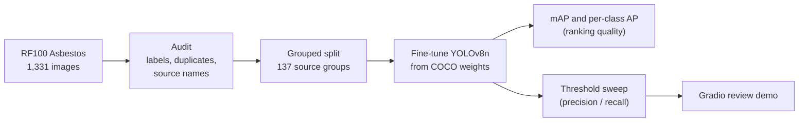
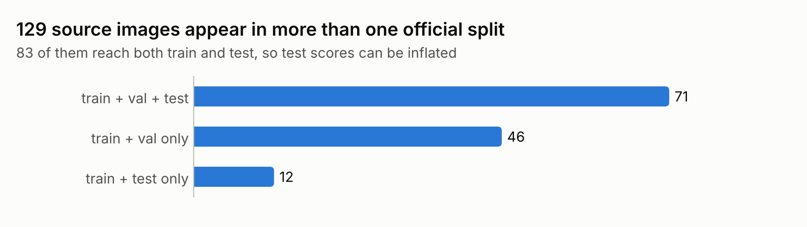
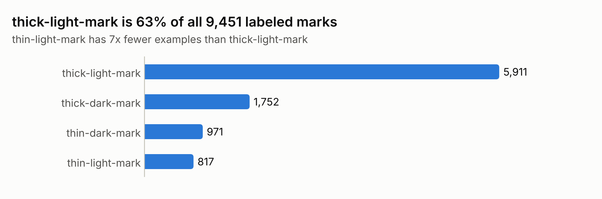
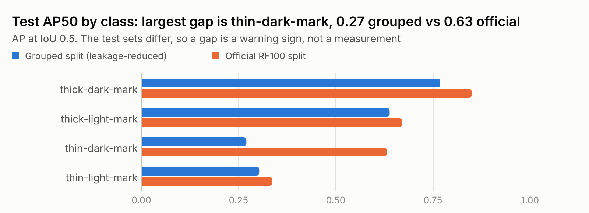

# Asbestos Fiber Mark Detection

Fine-tuning YOLOv8n to find four visual types of fiber marks in microscope
images, plus the checks needed to trust its numbers: a dataset audit that found
train/test leakage in the public benchmark, a leakage-reduced split, two kinds of
evaluation and a local review demo.

**Result:** 0.495 test mAP50 (0.328 mAP50-95) on the leakage-reduced split. The
official split scores 0.622, but both models score about 0.61 on validation,
which suggests most of that gap comes from a harder grouped test set rather than
leakage. See [Results](#results).

[](https://colab.research.google.com/github/sp-ankitprajapati/asbestos-fiber-detection/blob/main/notebooks/train_colab.ipynb)

> The labels **thick-dark**, **thick-light**, **thin-dark** and **thin-light**
> describe how a mark looks, not which asbestos mineral it is. The model can point
> a reviewer to marks worth checking; it cannot decide whether a material
> contains asbestos.

## Where this fits in an asbestos lab

Lab methods for building materials, such as JIS A 1481-1 (aligned with
ISO 22262-1), rely on a trained analyst at the microscope. The analyst
identifies asbestos from fiber shape and optical properties under polarized
light, such as refractive index, birefringence and extinction, and labs can
confirm results with XRD or SEM. Scanning many fields of view by eye is slow and
repetitive.

This project explores one small, assistive step: flagging fiber-like marks in an
image so a reviewer can look at the right places first. It does not identify
minerals or estimate asbestos content.

## Pipeline



## Key finding: the official split leaks

<picture>
  <source media="(prefers-color-scheme: dark)" srcset="assets/split_overlap_dark.png">
  
</picture>

Roboflow exports several variants of each source image, and they share a
**source name**: the file name before the `.rf.` suffix. In the official RF100
split, 129 source names appear in more than one split, and 83 of them reach both
train and test. A model trained there can see variants of its own test images,
so its test score can look better than its real performance. No two files are
byte-identical across splits, so a simple duplicate check misses this.

`make_grouped_split.py` puts every image that shares a source name, or has
identical bytes, into one group (a union-find over both keys), then assigns whole
groups to roughly 70/20/10 splits with seed 42. The 1,331 images collapse into
just **137 source groups**: 925 train, 273 validation and 133 test images, with
no source name in more than one split.

This is a partial safeguard. Images with different names can still come from the
same specimen, so it cannot prove specimen-level independence. It also replaces
the official benchmark split, so scores are not directly comparable with
published RF100 results. Full audit: [`reports/data_audit.json`](reports/data_audit.json).

## Data

[RF100 Asbestos](https://universe.roboflow.com/roboflow-100/asbestos): 1,331
images (932 train, 266 validation, 133 test) with 9,451 labeled marks. Credited
to Ahmad Rabiee and published by Roboflow 100 under CC BY 4.0; downloaded from
the [Libre-YOLO mirror](https://huggingface.co/datasets/Libre-YOLO/asbestos) at
pinned revision `24d72f5`.

<picture>
  <source media="(prefers-color-scheme: dark)" srcset="assets/class_balance_dark.png">
  
</picture>

The classes are imbalanced: thick-light marks are 63% of all labels, and
thin-light marks have about 7x fewer examples. Expect weaker results on the thin
classes, which is why evaluation reports AP per class, not only an average.

## Results

Both models were trained with the same settings (YOLOv8n from COCO weights,
100 epochs, batch 8, AdamW, seed 42) using the
[training notebook](notebooks/train_colab.ipynb) on Google Colab. Each run took
about 30 minutes. Both ran all 100 epochs and the last epoch was the best, so a
longer schedule might add a little.

| Trained and tested on | Test mAP50 | Test mAP50-95 |
| --- | --- | --- |
| Grouped split (main result) | **0.495** | **0.328** |
| Official RF100 split (comparison) | 0.622 | 0.406 |

<picture>
  <source media="(prefers-color-scheme: dark)" srcset="assets/per_class_ap_dark.png">
  
</picture>

**What the gap means.** The official split scores 0.127 higher in mAP50, but
that is not a clean measure of leakage:

- On validation data the two models score almost the same: 0.615 (grouped) and
  0.609 (official) mAP50 at the end of training
  ([summary](reports/results/training_summary.json)). The official validation
  set also shares 117 source names with training, so if leakage inflated scores
  strongly, its validation score should be clearly higher. It is not.
- The grouped model scores 0.105 lower on its own test set than on its
  validation set (0.495 vs 0.600 with `evaluate.py`). Whole source groups move
  together, so one 133-image test set can be much harder than another.
- Thin-dark marks show the same pattern: 0.27 AP50 on the grouped test set, but
  0.58 on grouped validation and 0.63 on the official test set.
- Thin-light marks, the rarest class, score low on every set (0.30–0.35 AP50).

The leakage itself is real: 83 test source names also appear in training. But
these runs suggest it is not the main reason for the score gap. Measuring its
effect directly needs one model evaluated on two parts of the same test set (see
Limitations).

**Choosing a review threshold.** Fixed-threshold results for the grouped model
on validation data (273 images, 1,912 labeled marks), from
[`grouped_val_thresholds.csv`](reports/results/grouped_val_thresholds.csv):

| Confidence | Precision | Recall | F1 |
| --- | --- | --- | --- |
| 0.10 | 0.45 | 0.68 | 0.54 |
| 0.25 | 0.63 | 0.61 | 0.62 |
| 0.40 | 0.74 | 0.54 | 0.62 |
| 0.50 | 0.79 | 0.48 | 0.60 |
| 0.60 | 0.84 | 0.42 | 0.56 |
| 0.75 | 0.92 | 0.29 | 0.44 |

At 0.25 the model finds 61% of the marks, and 63% of its flags are correct.
Raising the threshold makes flags more reliable but misses more marks. When the
tool points a reviewer to marks, a missed mark usually costs more than an extra
look, so 0.25 is a sensible starting point.

**How these results were produced.** Each evaluation file in `reports/results/`
records the checkpoint hash, data config hash, split and settings;
`grouped.metadata.json` and `official.metadata.json` hold the full training
settings and library versions. An earlier
[one-epoch CPU run](reports/verification.json) on a tiny subset at commit
`f324361` checked training, evaluation, the threshold sweep and the demo end to
end. The demo's color handling was fixed afterwards; unit tests cover the fix,
but the demo has not yet been run with the trained model. All 12 unit tests pass.

## Run it

### On Colab or Kaggle (recommended)

Open the notebook with the badge above, choose a **T4 GPU**, and run the cells in
order. Checkpoints and results are saved to Google Drive, and a resume cell
covers disconnects. The same notebook runs on Kaggle: upload it, choose a GPU T4
accelerator, turn Internet on and use **Save & Run All**; results are saved in
the notebook's Output.

### Locally

Use Python 3.12. Install a [PyTorch build](https://pytorch.org/get-started/locally/)
for your CPU or GPU, then, from the repository root:

```bash
python -m venv .venv
# Windows PowerShell: .\.venv\Scripts\Activate.ps1
# Linux/macOS: source .venv/bin/activate
python -m pip install -r requirements.txt
python prepare_data.py          # download pinned data and audit it
python make_grouped_split.py    # build the leakage-reduced split
```

Train (use `--device cpu` without a GPU; reduce `--batch` if memory is short):

```bash
python train.py --data asbestos/grouped/data.yaml --epochs 100 --imgsz 640 --batch 8 --device 0
```

Training uses AdamW (learning rate 0.001), seed 42 and early stopping after 20
epochs without improvement, so 100 epochs is a maximum. The best checkpoint and
its metadata go to `weights/best.pt` and `weights/best.metadata.json`.
Variations:

```bash
# Freeze the backbone (first ten modules) to compare a lighter fine-tune
python train.py --data asbestos/grouped/data.yaml --freeze 10 --lr0 0.0005 --name frozen10 --output weights/frozen10.pt --device 0
# Continue an interrupted run
python train.py --resume runs_out/yolov8n_baseline/weights/last.pt --device 0
```

Evaluate on validation data, choose settings, and only then touch the test split:

```bash
python evaluate.py --data asbestos/grouped/data.yaml --split val --output reports/evaluation_val.json
python threshold_sweep.py --data asbestos/grouped/data.yaml
python evaluate.py --data asbestos/grouped/data.yaml --split test --output reports/evaluation_test.json
```

Demo, then open <http://127.0.0.1:7860>:

```bash
python app.py
```

Unit tests and figures:

```bash
python -m unittest discover -s tests -v
python make_figures.py
```

## Design decisions

- **Transfer learning.** Training starts from COCO-pretrained YOLOv8n (3.14M
  parameters), not random weights, because 925 training images are too few to
  learn general visual features from scratch. `--freeze 10` freezes the backbone
  and cuts trainable parameters to 1.87M. Whether that helps accuracy has to be
  measured on the same split and training budget.
- **Two kinds of evaluation.** `evaluate.py` reports mAP50, mAP50-95 and
  per-class AP, which score ranking quality across all confidence levels. Its
  summary precision and recall are Ultralytics' best-F1 values.
  `threshold_sweep.py` answers a reviewer's question instead: at one fixed
  confidence setting, how many marks are found (recall) and how many flags are
  wrong (precision)?
- **Matching written from scratch.** `detection_metrics.py` processes predictions
  in descending confidence; each one claims the unused same-class target with the
  highest IoU, and counts as correct only at IoU ≥ 0.5. Matching IoU (0.5) and
  NMS IoU (0.7) are different settings: NMS removes the model's duplicate boxes,
  while matching decides whether a box is right.
- **Validation chooses, test confirms.** Models and thresholds are chosen on
  validation data. The test split is evaluated once, after those choices are
  fixed.
- **Confidence is not probability.** A score of 0.8 is an uncalibrated model
  score, not an 80% chance that a mark is asbestos.
- **Color order in the demo.** Gradio provides RGB images, but Ultralytics reads
  NumPy input as BGR, OpenCV's order. The demo flips channels before prediction
  and flips the annotated output back for display; `tests/test_app.py` checks
  both directions.
- **Reproducibility.** The dataset revision is pinned, training is seeded, and
  every checkpoint gets a metadata file with its hash, settings and library
  versions.

## Limitations

- Noisy test estimate: the grouped test and validation sets differ by 0.105
  mAP50 for the same model. Grouped k-fold cross-validation would give a steadier
  estimate.
- The leakage effect is not measured directly. Evaluating the official model
  separately on test images whose source appears in training and on those whose
  source does not would measure it.
- Appearance labels only: no mineral identification, OCR, segmentation or
  asbestos-content estimate.
- Grouping by source name reduces leakage but cannot prove specimen-level
  independence.
- One public dataset. Results may not transfer to other microscopes,
  magnifications or sample preparations.
- Confidence scores are not calibrated probabilities.

## Files

| File | Purpose |
| --- | --- |
| `prepare_data.py`, `data_utils.py` | Pinned download, label validation and split audit |
| `make_grouped_split.py` | Leakage-reduced split by source name and exact copies |
| `train.py` | Fine-tuning, freezing, resume and checkpoint metadata |
| `evaluate.py` | mAP and per-class AP export |
| `threshold_sweep.py`, `detection_metrics.py` | Fixed-threshold precision, recall and F1 |
| `app.py` | Local Gradio review demo |
| `make_figures.py` | README charts from saved reports |
| `notebooks/train_colab.ipynb` | Full training and evaluation on a Colab or Kaggle GPU |
| `tests/` | Label validation, grouping, matching and demo checks |
| `reports/` | Data audit, execution check, and training and evaluation results |

Model weights, downloaded images and training runs stay out of Git.

## Attribution and dependencies

Dataset: [Roboflow 100 / Asbestos](https://universe.roboflow.com/roboflow-100/asbestos),
original contributor Ahmad Rabiee, CC BY 4.0, accessed through the Libre-YOLO
mirror; see the [RF100 benchmark paper](https://arxiv.org/abs/2211.13523).
Model and training library: [Ultralytics](https://github.com/ultralytics/ultralytics),
available under AGPL-3.0 or an enterprise license. Dataset and dependency licenses
apply independently. No dataset images or pretrained weights are stored here; if
you commit the notebook's sample-prediction figure, it shows dataset images under
the CC BY 4.0 license and credit above.
